<p align="center">
  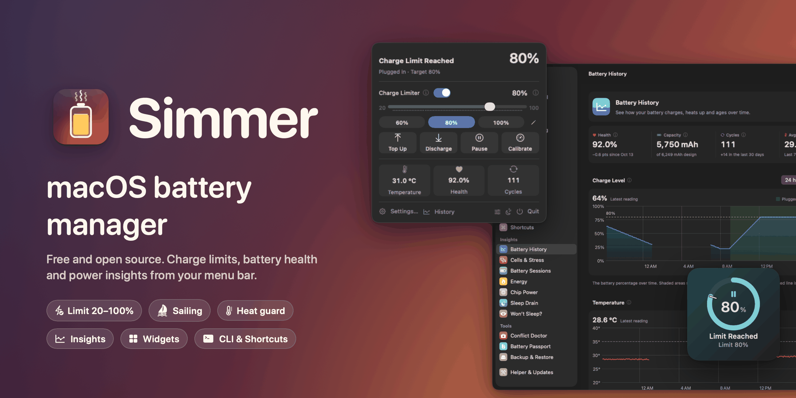
</p>

<p align="center"><a href="https://umarwaseeem.github.io/simmer/"><b>Website: umarwaseeem.github.io/simmer</b></a></p>

<h1 align="center">Simmer</h1>

<p align="center">
  <b>macOS battery manager: a free, open-source charge limiter with battery insights.</b><br>
  Hold your MacBook at 80% (or anywhere from 20% to 100%) and see what your battery is really doing.
</p>

<p align="center">
  <a href="LICENSE"></a>
  
  
  <a href="https://github.com/umarwaseeem/simmer/releases/latest"></a>
  <a href="https://github.com/umarwaseeem/simmer/actions/workflows/ci.yml"></a>
</p>

<p align="center">
  <a href="#install">Install</a> ·
  <a href="#what-simmer-can-do">Features</a> ·
  <a href="#screenshots">Screenshots</a> ·
  <a href="#usage">Usage</a> ·
  <a href="docs/FAQ.md">FAQ</a> ·
  <a href="docs/HOW-IT-WORKS.md">How it works</a> ·
  <a href="CONTRIBUTING.md">Contributing</a>
</p>

---

> **Why the name?** Pasta is cooked *al dente*. A battery is happiest at a *simmer*: warm enough to
> be useful, never at a rolling boil. Simmer keeps your charge below the boil.

## Install

**Requires macOS 14 Sonoma or later.** Apple silicon is fully supported; Intel Macs are in beta.

**Download:** get **`Simmer-x.y.z.dmg`** from the [latest release](https://github.com/umarwaseeem/simmer/releases/latest), open it and drag **Simmer** to **Applications**.

**Homebrew:**

```sh
brew tap umarwaseeem/simmer https://github.com/umarwaseeem/simmer
brew install --cask simmer
```

**First launch, in three steps:**

1. **Right-click Simmer → Open** (once). The app is not signed with a paid Apple Developer ID, so macOS asks. On macOS 15+ use **System Settings → Privacy & Security → Open Anyway**, or run `xattr -dr com.apple.quarantine /Applications/Simmer.app`.
2. **Enter your password** when Simmer installs its charging helper. Changing how a Mac charges needs root; [why and how it is kept safe](#first-launch).
3. **Click the jar icon** in the menu bar and pick a limit. 80% is a good start for a Mac that is mostly plugged in.

## What Simmer can do

| | |
|---|---|
| 🔋 **Charge limit 20–100%** | Stops charging at your limit while the charger keeps powering the Mac. Goes below the 80% floor of the built-in macOS limit. |
| ⛵️ **Sailing & heat protection** | Lets the battery drift a few percent before charging again, and pauses charging when the battery is hot. |
| ⬇️ **Discharge & top up** | Run from the battery while plugged in to come down to your limit, or charge to 100% once before a trip. |
| 🎯 **Calibration** | A guided full cycle that keeps the battery percentage accurate. |
| 🧠 **Smart charging** | Desk mode for long clamshell use, a "ready by" top-up that learns when you unplug, and cheap or green charging windows. |
| 📊 **Battery insights** | History charts, health and cycles, cell balance, power flow, battery sessions and chip power. |
| 🕵️ **What drains your battery** | Top energy apps and processes, what woke your Mac at night, and what keeps it from sleeping. |
| 🔌 **Charger report** | Tells you in plain words whether your charger and cable are strong enough. |
| 💡 **MagSafe LED** | Smart or custom colors per state, and blink notifications you can script. |
| 🧩 **Widgets, Shortcuts, CLI** | 6 desktop widgets, 22 Shortcuts actions, a `simmer://` URL scheme, `simmerctl` and a Raycast extension. |
| 🗓️ **Schedule** | Run tasks at set times, for example a Monday morning top-up or a monthly calibration. |
| 🛟 **Housekeeping** | Conflict doctor, settings backup and restore, and a battery passport PDF for when you sell your Mac. |

Every feature is free. There is no account and no telemetry.

## Screenshots

<table>
<tr>
<td width="34%" valign="top" align="center">
<picture>
  <source media="(prefers-color-scheme: dark)" srcset="docs/images/screenshots/panel-dark.png">
  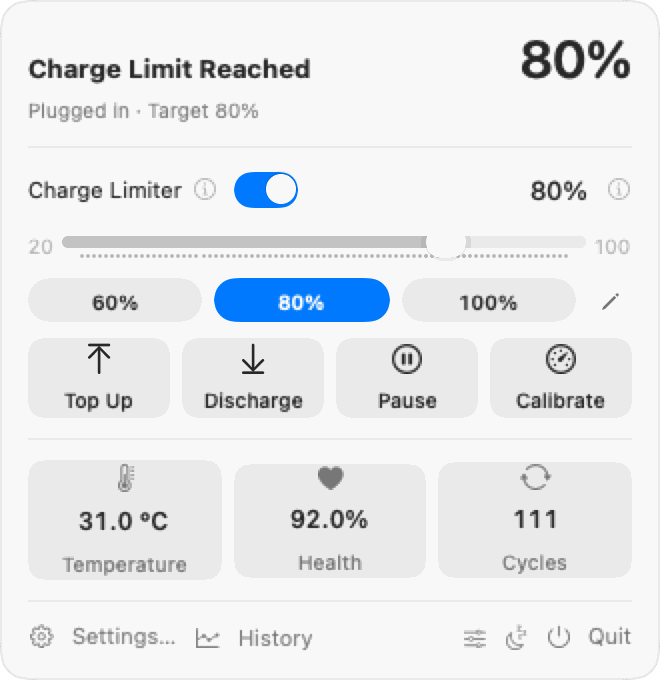
</picture>
<br><sub>The menu bar panel</sub>
</td>
<td valign="top" align="center">
<picture>
  <source media="(prefers-color-scheme: dark)" srcset="docs/images/screenshots/settings-history-dark.png">
  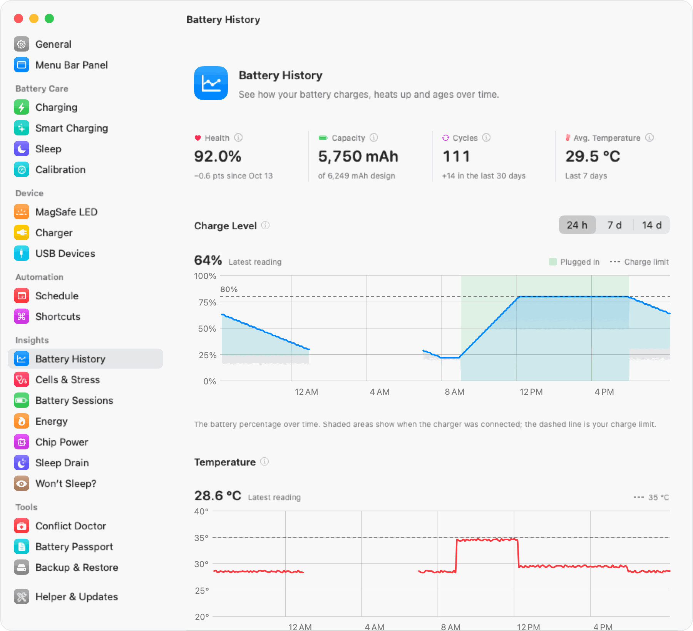
</picture>
<br><sub>Battery history</sub>
<br><br>
<picture>
  <source media="(prefers-color-scheme: dark)" srcset="docs/images/screenshots/widgets-dark.png">
  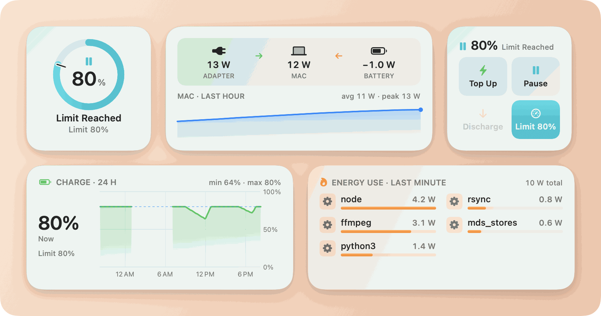
</picture>
<br><sub>Desktop widgets</sub>
</td>
</tr>
</table>

| | |
|---|---|
| 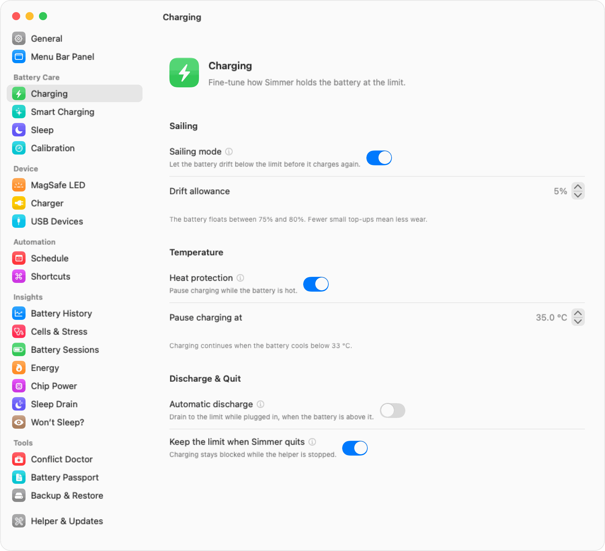 | 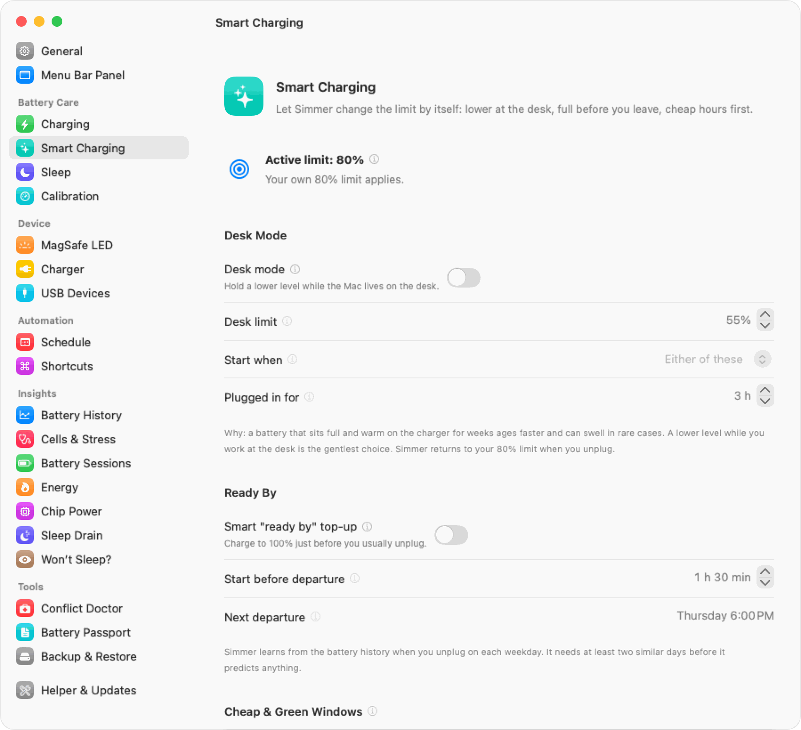 |
| Charging | Smart charging |
| 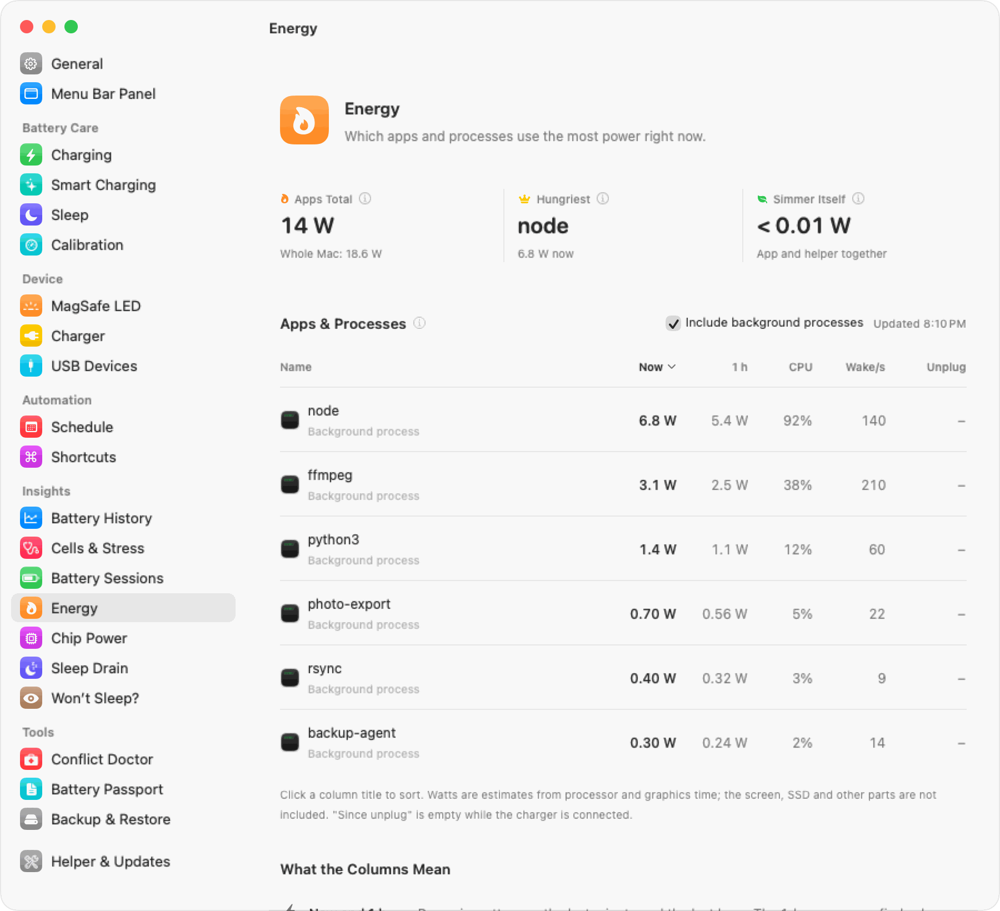 | 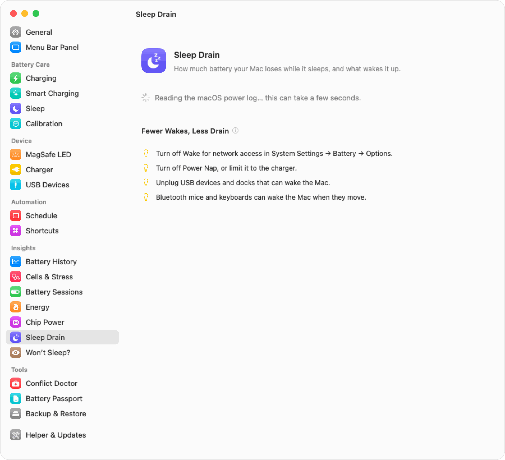 |
| Energy | Sleep drain |
| 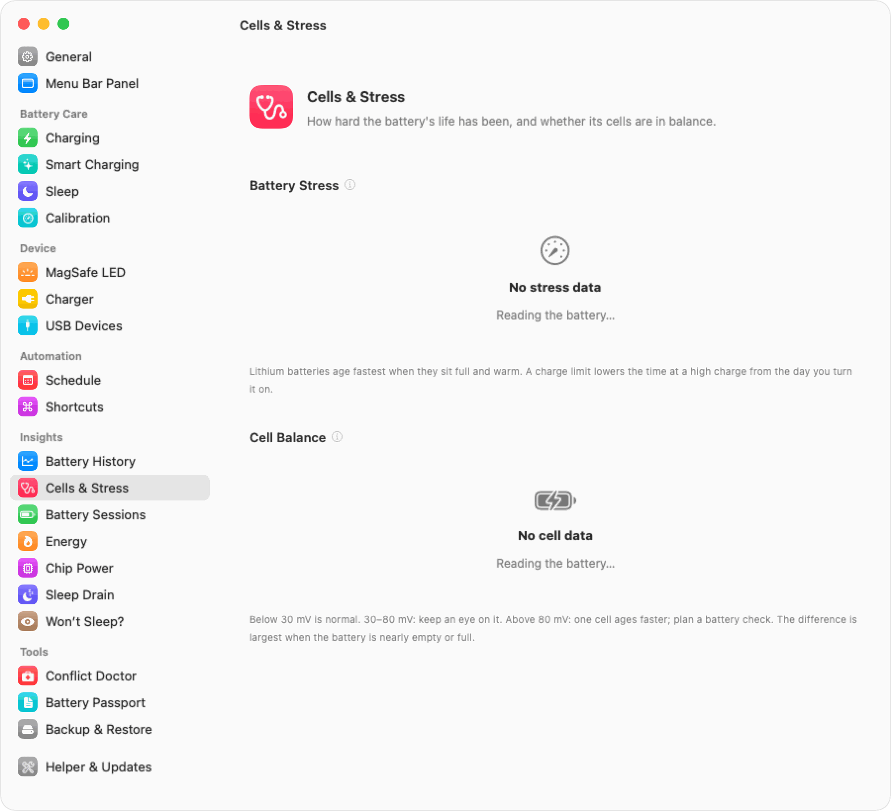 | 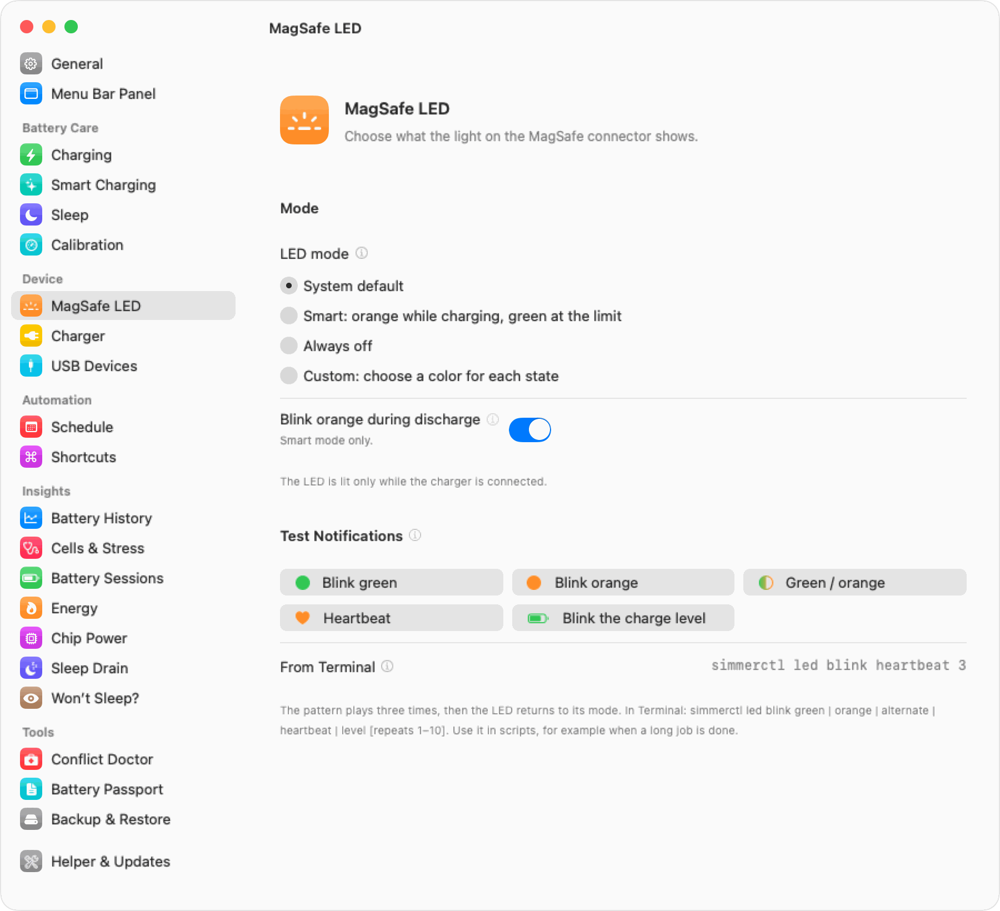 |
| Cells & stress | MagSafe LED |
| 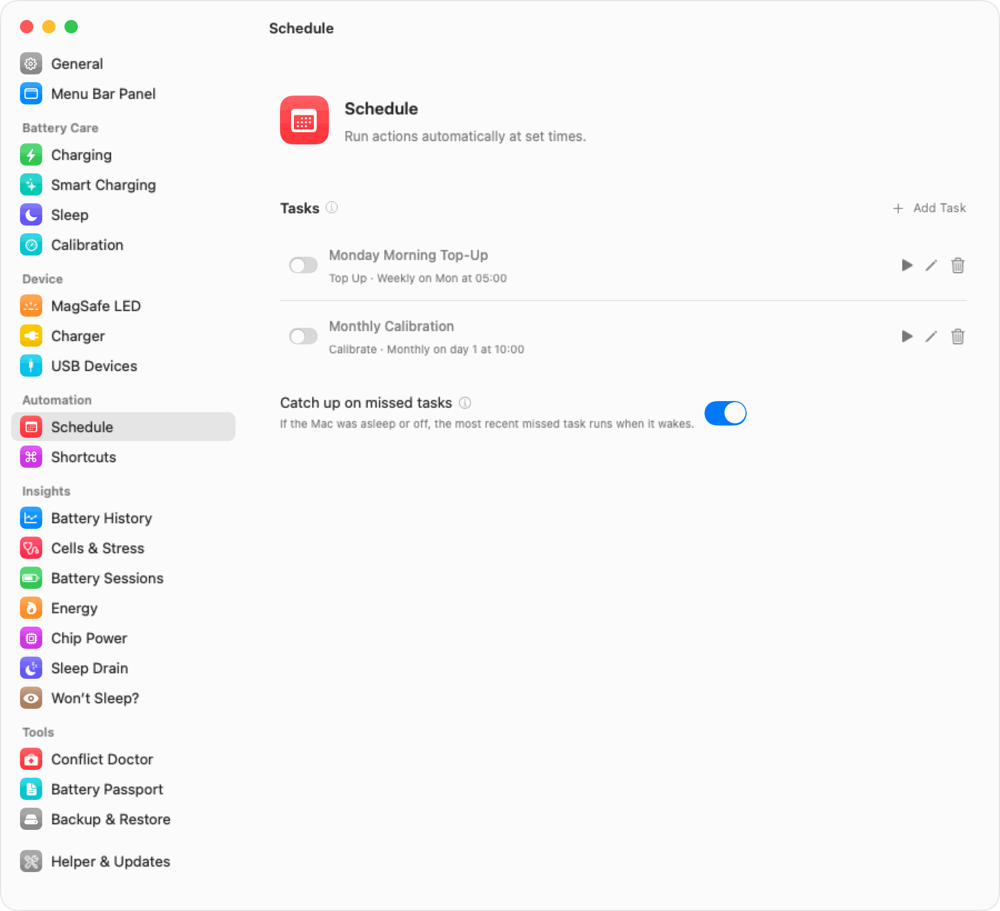 | 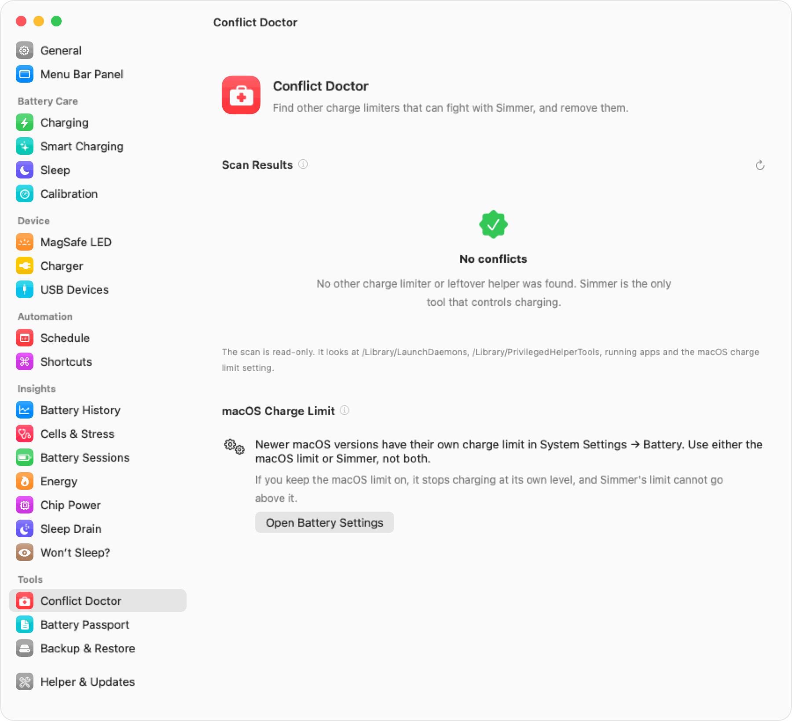 |
| Schedule | Conflict doctor |

## Why Simmer

Lithium-ion batteries age fastest when they sit **full** and **warm**. A MacBook that lives on its
charger spends most of its life at 100%, often warm from work, and that is the worst place for the
cells. Holding the charge lower, for example at 60–80%, slows that wear a lot. You give up some
range on days you do not need it, and you keep more capacity for the years you do.

macOS can help a little. *Optimized Battery Charging* learns your routine, and macOS 26.4 adds a
**Charge Limit** setting. But the native limit goes no lower than **80%**, it cannot run the Mac from
the battery while plugged in, and it shows you almost nothing about *why* the battery drains.

Simmer gives you the full range (**20% to 100%**), the controls that make a limit practical every day
(sailing, heat protection, discharge, top up, calibration, schedules), and insights into charge,
temperature, health, sleep drain and which apps eat your battery. It is free, has no account and no
telemetry, and every line is open source.

## All features

<table>
<tr>
<td width="50%" valign="top">

### 🔋 Charging
- **Charge limit 20–100%**, enforced in hardware by the SMC
- **Sailing mode**: let the charge drift a few percent below the limit before it charges again
- **Heat protection**: pause charging while the battery is hot
- **Discharge while plugged in**, also with the lid closed (Simmer keeps the Mac awake)
- **Automatic discharge** when the charge is above the limit
- **Top up** to 100% once, for a long day away from a socket
- **Calibration**: a guided full cycle to recalibrate the battery gauge
- **Stop charging when sleeping** and **disable sleep until the limit** is reached
- **Keep the limit** when Simmer quits

</td>
<td width="50%" valign="top">

### 🧠 Smart charging
- **Desk mode**: a lower limit when the Mac stays plugged in for days
- **Smart "ready by" top-up**: charge to 100% just before you usually leave
- **Cheap or green charging windows**: prefer the hours you choose
- **Schedule** with templates and catch-up for events the Mac slept through
- **Low Power and High Power modes**, separately on battery and on charger

### 💡 MagSafe LED
- System, smart, off, or **custom colors per charging state**
- **LED notifications**: blink when the limit is reached or the battery is hot

</td>
</tr>
<tr>
<td valign="top">

### 📊 Insights
- **Battery history** charts: charge, temperature, power, health over 24 h to 30 days
- **Top energy apps and processes**, with an estimate in watts
- **Sleep drain detective** and **"Why won't my Mac sleep?"**
- **Battery sessions**, **component (chip) power**, **USB device power**
- **Charger report**: is your charger strong enough?
- **Battery stress meter** and **cell balance**
- **Battery passport**: a PDF with the battery's health record
- **Power flow** and **hardware percentage** in the menu bar panel

</td>
<td valign="top">

### ⚙️ Control it your way
- **Menu bar panel** you can rearrange, plus menu bar extras
- **Desktop widgets**: battery, power flow, history, top apps, charger, and interactive controls
- **Shortcuts actions** (App Intents) and the **`simmer://` URL scheme**
- **`simmerctl`** command-line tool
- **Raycast extension**
- **Notifications** for limit reached, heat, calibration and more

### 🛟 Safety and housekeeping
- **Conflict doctor**: finds the native macOS Charge Limit and leftover helpers of other tools
- **Settings backup and restore**
- **Automatic updates** (Sparkle, EdDSA-signed)
- **Intel Macs**: beta, help us test (see [INTEL-TESTING.md](docs/INTEL-TESTING.md))

</td>
</tr>
</table>

## First launch

**1. Open it once with right-click.** Simmer is signed *ad hoc*, not with a paid Apple Developer ID,
so Gatekeeper blocks a normal double-click the first time. Right-click **Simmer** in Applications,
choose **Open**, then **Open** again. (On macOS 15 and later you may need **System Settings →
Privacy & Security → Open Anyway**.) Or run:

```sh
xattr -dr com.apple.quarantine /Applications/Simmer.app
```

**2. Install the helper.** Simmer asks for your administrator password once to install its charging
helper. **Why root?** Charging is controlled by the System Management Controller (SMC), and macOS
lets only root write SMC keys. So Simmer is split in two:

- **Simmer.app** runs as you. It shows the panel, settings, widgets and insights. It never writes
  to the hardware.
- **simmerd** is a small LaunchDaemon (`com.umarwaseem.simmer.helper`) that runs as root. It is
  the *only* part that writes SMC keys. It applies your limit every few seconds, also while the app
  is closed.

**Security model.** The helper listens on one XPC Mach service and accepts only clients whose code
signature carries Simmer's identifiers (the app and `simmerctl`). It offers a fixed set of commands
with checked ranges: set a limit, start a top up, change the LED, and so on. It never runs shell
commands or opens paths that a client sends. Read [SECURITY.md](SECURITY.md) for the details and
the limits of ad-hoc signing.

**3. Pick a limit.** Click the menu bar icon and set the limit. 80% is a good start for a Mac that
is mostly plugged in.

## Usage

### Menu bar panel and settings

The panel shows the state, the limit slider, quick buttons (Top Up, Discharge, Pause, Calibrate),
your charger, the power flow, battery stats and the top energy apps. You can reorder or hide the
sections in **Settings → Menu Bar Panel**. Every setting has an ⓘ button that explains it.

### Command line

The helper installs `simmerctl` to `/usr/local/bin`:

```sh
simmerctl status              # battery, charging state and power flow (--json for scripts)
simmerctl limit 80            # set the charge limit (20-100)
simmerctl topup on            # charge to 100% once
simmerctl discharge on        # run from the battery down to the limit while plugged in
simmerctl pause               # set the limit to the current percentage
simmerctl limiter off         # charge normally, like macOS
simmerctl led smart           # MagSafe LED: system | smart | off | custom
simmerctl set sailing on      # any setting: see `simmerctl help`
```

### URL scheme

Every link works from a browser, a script (`open "simmer://limit/80"`) or another app:

| URL | Does |
|---|---|
| `simmer://limit/80` | Set the charge limit |
| `simmer://topup` · `simmer://topup/off` | Start or stop a top up |
| `simmer://discharge` · `simmer://discharge/off` | Start or stop discharging |
| `simmer://calibrate` · `simmer://calibrate/stop` | Start or stop calibration |
| `simmer://pause` | Hold at the current percentage |
| `simmer://limiter/on` · `simmer://limiter/off` | Turn the limiter on or off |
| `simmer://led/smart` | MagSafe LED mode (`system`, `smart`, `off`, `custom`) |
| `simmer://lpm/on` · `simmer://hpm/on` | Low Power / High Power Mode |
| `simmer://sleep` | Sleep now |

### Shortcuts

Simmer adds actions to the Shortcuts app, for example **Set Charge Limit**, **Start Charging**,
**Stop Charging**, **Calibrate Battery**, **Turn Charge Limiter On or Off**, **Set MagSafe LED**,
**Blink MagSafe LED**, **Set Low Power Mode**, **Set High Power Mode**, **Sleep Now**, and
information actions such as **Get Battery Percentage**, **Get Charging State**, **Get Battery
Health**, **Get Cycle Count**, **Get Battery Temperature** and **Get Charge Limit**. Use them in
Automations, for example "when I connect to the office Wi-Fi, set the limit to 60%".

### Widgets

Right-click the desktop → **Edit Widgets** → search for **Simmer**. Kinds: **Battery**, **Power Flow**,
**Battery History** (charge, temperature, power or health), **Top Energy Apps**, **Charger & Health**,
and **Charging Controls** with interactive buttons. Each one is configurable.

### Raycast

The [Raycast extension](raycast/) has Battery Status, Set Charge Limit, Charge to 100% Once,
Discharge to Limit, Pause Charging Here and Toggle Charge Limiter. It runs `simmerctl`.

## Using other charge limiters

**Do not run two charge limiters at once.** Charge limiters write the same SMC keys and would fight:
one stops charging, the other starts it again. Remove the other tool's helper first.
**Settings → Conflict Doctor** finds leftover helpers of other tools and the macOS native Charge Limit.

## FAQ

<details>
<summary><b>Is it safe for my battery?</b></summary>

Simmer uses the same SMC charging switches that macOS and other limiters use. It does not change
voltages or currents. If anything goes wrong, uninstalling the helper restores normal charging.
</details>

<details>
<summary><b>Why does macOS show 80% while the battery is "not charging"?</b></summary>

That is the limit at work: the charger powers the Mac, and the battery rests. macOS may also show a
percentage that differs a little from the hardware percentage (Settings → General → hardware
percentage).
</details>

<details>
<summary><b>Does Simmer keep the limit when the Mac sleeps or is shut down?</b></summary>

While the Mac sleeps, Simmer can stop charging before sleep (Settings → Sleep →
**Stop charging when sleeping**). When the Mac is
shut down, Apple silicon Macs can charge past the limit until macOS and the helper start again. On Intel Macs
with the BCLM key the limit also holds while the Mac is off.
</details>

<details>
<summary><b>Does Simmer collect any data?</b></summary>

No. There is no telemetry and no account. The only network request is the update check (Sparkle),
which you can turn off. See [docs/PRIVACY.md](docs/PRIVACY.md).
</details>

More in [docs/FAQ.md](docs/FAQ.md).

## Uninstall

1. Open **Settings → Helper & Updates → Uninstall Helper…**. This restores default charging, then
   removes the helper and `simmerctl`.
2. Quit Simmer and move it to the Trash.

From Terminal instead:

```sh
sudo /Applications/Simmer.app/Contents/Resources/uninstall-helper.sh --purge
rm -rf /Applications/Simmer.app
```

With Homebrew: `brew uninstall --zap --cask simmer`.

## Build from source


```sh
brew install xcodegen
git clone https://github.com/umarwaseeem/simmer.git && cd simmer
make app            # universal, ad-hoc signed dist/Simmer.app
open dist/Simmer.app
```

You need Xcode 26 or later. See [docs/BUILDING.md](docs/BUILDING.md) for details.


## Contributing

Bug reports, Intel test reports, translations and pull requests are very welcome. Start with
[CONTRIBUTING.md](CONTRIBUTING.md). For a bug, please include `simmerctl status --json`, your Mac
model and your macOS version. Everyone who takes part follows the
[Code of Conduct](CODE_OF_CONDUCT.md).

- [How it works](docs/HOW-IT-WORKS.md): SMC keys per Mac family and verified macOS 26 behaviors
- [Architecture](docs/ARCHITECTURE.md): the app, the helper, the CLI and the widget
- [Building](docs/BUILDING.md) · [Releasing](docs/RELEASING.md) · [Intel testing](docs/INTEL-TESTING.md)

## Credits

- Built by [Umar Waseem](https://github.com/umarwaseeem).
- Thanks to the open-source tools that documented the SMC charging keys: [bclm](https://github.com/zackelia/bclm),
  [batt](https://github.com/charlie0129/batt), [Battery Toolkit](https://github.com/mhaeuser/Battery-Toolkit)
  and [battery](https://github.com/actuallymentor/battery).
- Updates by [Sparkle](https://sparkle-project.org) (MIT license, see [THIRD-PARTY-NOTICES.md](THIRD-PARTY-NOTICES.md)).
  In-app icons are Apple SF Symbols, used under Apple's license for apps on Apple platforms.

Simmer is an independent open-source project and is not affiliated with or endorsed by Apple Inc.
Apple, Mac, MacBook, MagSafe, macOS and Shortcuts are trademarks of Apple Inc., registered in the U.S.
and other countries. All other product names are trademarks of their respective owners.

## Disclaimer

Simmer changes how your Mac charges by writing to the System Management Controller (SMC). It is
provided **as is, without any warranty** (see the GPL-3.0 license, sections 15–16). Use it at your own
risk. If anything seems wrong, uninstall the helper (**Settings → Helper & Updates → Uninstall**, or
`sudo /Library/PrivilegedHelperTools/com.umarwaseem.simmer.helper --reset`): your Mac returns to normal
Apple charging.

## License

Simmer is free software under the [GNU General Public License v3.0](LICENSE). You can use, study,
share and change it. If you distribute a changed version, you share its source under the same
license. The [Raycast extension](raycast/) is MIT-licensed, as the Raycast Store requires.
